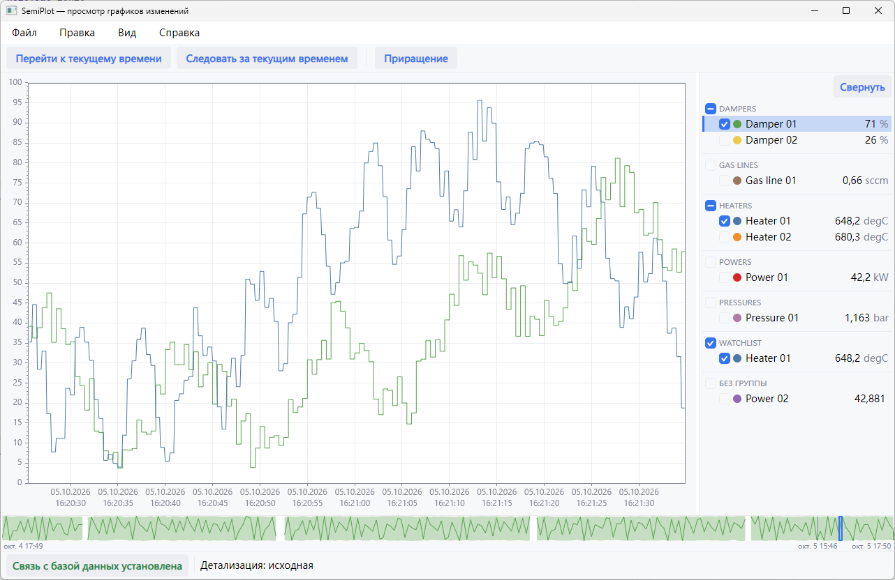
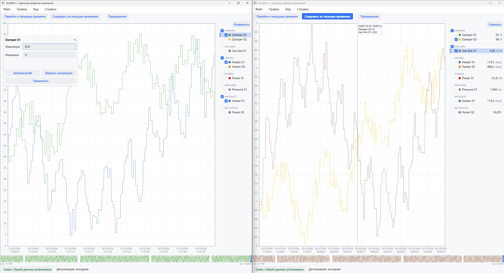
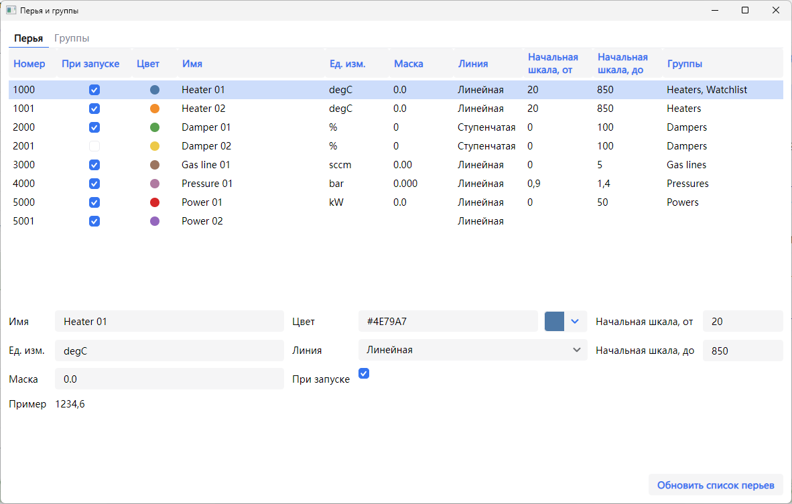
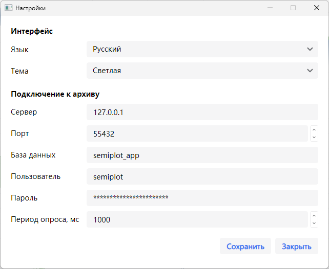

# SemiPlot

[](https://github.com/Semiteq/SemiPlot/actions/workflows/ci.yml)


<div align="center">
    
</div>

SemiPlot — программа просмотра трендов технологических параметров промышленных установок. Она читает
архив Simple-Scada 2 в СУБД PostgreSQL и отображает архивные данные и значения в реальном времени.

[Документация](./docs/architecture/README.md)

<div align="center">
    
    <p><em>Главное окно: график, условные обозначения по группам, миникарта архива</em></p>
</div>

<div align="center">
    
    <p><em>Два окна: у каждого свой набор перьев и свой интервал времени</em></p>
</div>

## Возможности

**Тренды**

- Отдельная шкала у каждого пера. На графике отображается ось активного пера; щелчок по оси открывает
  панель настройки шкалы.
- Логарифмическая шкала (log10) для перьев, значения которых охватывают несколько порядков, например
  давления. Флажок «Логарифмическая шкала» в панели шкалы переключает её в текущем окне.
- Курсор показывает значения всех видимых перьев в выбранной точке. В режиме «Приращение» два щелчка
  ставят два курсора, а рядом с кнопкой видны Δt и Δy активного пера между ними.
- Метки времени: двойной щелчок по графику ставит вертикальную линию с порядковым номером вида `#1` и временем, то
  же делает пункт «Добавить метку здесь» в меню правой кнопки. Метку можно перетащить мышью, двойной щелчок по метке
  удаляет её, а щелчок правой кнопкой по метке открывает меню «Переименовать» и «Удалить»; подпись
  необязательна, до 80 символов. Метки хранятся
  в архиве и видны во всех открытых окнах и после перезапуска, а на полосе обзора архива внизу каждая
  метка отмечена штрихом. На каждой метке точка и число показывают
  значение активного пера в её момент; при наведении на метку курсор показывает значения всех видимых
  перьев.
- Изменение масштаба и сдвиг по времени, переход к текущему времени, режим «Следовать за текущим
  временем».
- Щелчок по шкале времени открывает панель интервала: начало и конец задаются датой и временем, ширина
  вводится вручную или выбирается из списка от 1 минуты до 1 часа. Дни без записей в архиве в календаре
  недоступны.
- Колесо мыши над осью активного пера растягивает и сжимает его шкалу относительно указателя. Ctrl + колесо
  и Ctrl + перетаскивание сдвигают активное перо по вертикали, Shift + колесо сдвигает окно по времени на
  десятую часть его ширины. Перо в автомасштабе после сдвига или растяжения шкалы переходит в ручной масштаб, а команда
  «Вид → Шкала пера → Автомасштаб» возвращает автомасштаб. Горизонтальная прокрутка без Shift ничего не
  меняет.
- Слой архива (исходные данные, минутный, часовой) выбирается автоматически для установленного масштаба и числа видимых перьев: при большом числе видимых перьев грубый слой включается раньше. Точки группируются и соединяются с учетом экстремумов.
- Миникарта показывает весь архив с графиком активного пера и время в точке под указателем мыши.

**Перья и группы**

- Условные обозначения сгруппированы; у каждого пера отображается текущее значение по его маске, у
  каждой группы — переключатель видимости всех её перьев.
- Окно «Правка → Перья и группы» задаёт имя, единицу измерения, маску, цвет, тип линии, начальную
  шкалу пера, логарифмическую шкалу при запуске и состав групп.
- Изменения каталога перьев применяются во всех открытых окнах без перезапуска.
- Новые переменные Simple-Scada добавляются в каталог кнопкой «Обновить список перьев».

**Окна и настройки**

- Команда «Файл → Новое окно» запускает независимый экземпляр программы.
- Команда «Файл → Экспорт в CSV...» записывает в файл CSV исходные строки архива выбранных перьев за
  интервал до 24 часов одной таблицей по времени: перо, время, значение. Заголовок следует языку интерфейса, а
  разделитель и десятичный знак берутся из региональных настроек Windows.
- Окно «Правка → Настройки» задаёт язык интерфейса, тему оформления и параметры подключения к архиву.
  Смена темы применяется во всех открытых окнах сразу.
- Панель сообщений собирает все ошибки чтения и записи.
- При ошибке запуска программа открывает окно ошибки, из которого доступны настройки и перезапуск.

<div align="center">
    
    <p><em>Окно перьев и групп</em></p>
</div>

<div align="center">
    
    <p><em>Окно настроек</em></p>
</div>

## Требования

| Компонент            | Требование                                                                                       |
| -------------------- | ------------------------------------------------------------------------------------------------ |
| Операционная система | Windows 10 или Windows 11, 64-разрядная                                                          |
| Источник данных      | Архив Simple-Scada 2 в PostgreSQL, установленный [SemiBase](https://github.com/Semiteq/SemiBase) |
| Конфигурация         | Каталог с разделами `app/` и `connection/`; образец — `ConfigFiles/`                             |

Метки времени требуют SemiBase 0.6.0 или новее: эта версия создаёт таблицу `semiplot_markers`.

Начиная с версии 2.7.5.0 Simple-Scada не пишет суточный слой. Самый грубый слой SemiPlot — часовой,
поэтому программа одинаково работает с архивами любой версии.

## Запуск

```powershell
.\SemiPlot.UI.exe --config-dir <каталог конфигурации> --log-file <каталог журнала>\semiplot.log --logging-level info
```

Пароль к архиву задаётся в окне «Правка → Настройки». Без пароля программа открывает окно ошибки
запуска, из которого доступны те же настройки.
